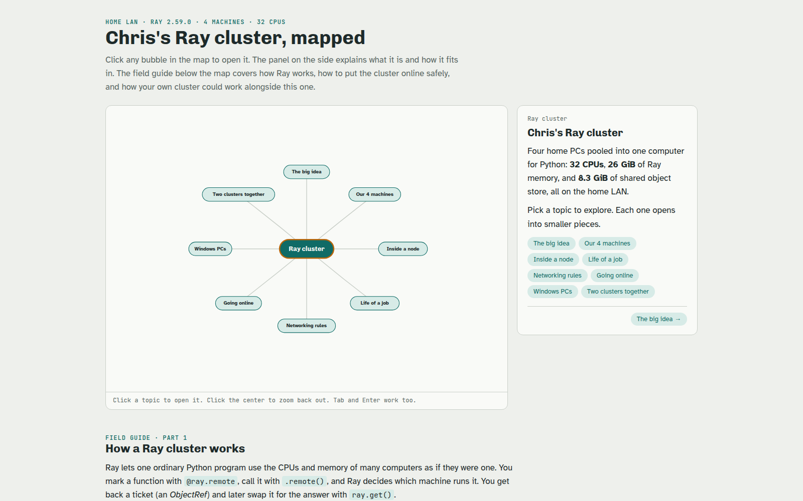

# Home compute cluster

Four home PCs pooled into one Python compute cluster with [Ray](https://www.ray.io/): 32 CPU threads and about 26 GiB of Ray memory, plus a headless Ubuntu server that runs the cluster head, containers and backups. Built in October 2026 by directing AI coding tools (Claude Code and OpenAI Codex).

**[Open the interactive mind map](docs/cluster-mind-map.html)** (download and open in a browser). I made it to teach a family member how the cluster works.

## The machines

| Machine | Role | CPU threads |
| --- | --- | --- |
| minipc | Ray head, server (Ubuntu Server) | 8 |
| Desktop (Zorin OS) | worker, the workhorse | 16 |
| Second desktop | worker | 4 |
| pc3, an old Windows 7 PC rebuilt as Ubuntu Server | worker | 4 |

Monitoring runs on the head with the Ray dashboard, Prometheus and Grafana.

## What is in here

| Folder | What it is |
| --- | --- |
| `pc3-network-install/` | How an old Windows 7 PC became a cluster node with no USB stick: the server answers its network boot (dnsmasq and iPXE), Ubuntu installs unattended from a cloud-init file, then a script joins it to the cluster as a service that survives reboots. |
| `minipc-setup/` | The numbered setup kit for the server: first login, SSH locked to keys only, Docker, a local AI model server (Ollama) and a camera recorder (Frigate). |
| `docs/minipc-runbook.md` | The step-by-step runbook: every command, what you should see after it, and the fixes found along the way (for example, broken IPv6 on the home network stalling downloads). |
| `docs/cluster-mind-map.html` | The interactive mind map. |

## Notes

- Addresses, keys and password hashes are replaced with placeholders such as `<HEAD_IP>` and `<YOUR_SSH_PUBLIC_KEY>`.
- Ray has no login by default. The cluster stays on the home network; anything remote goes through a private VPN (Tailscale), never port forwarding.
